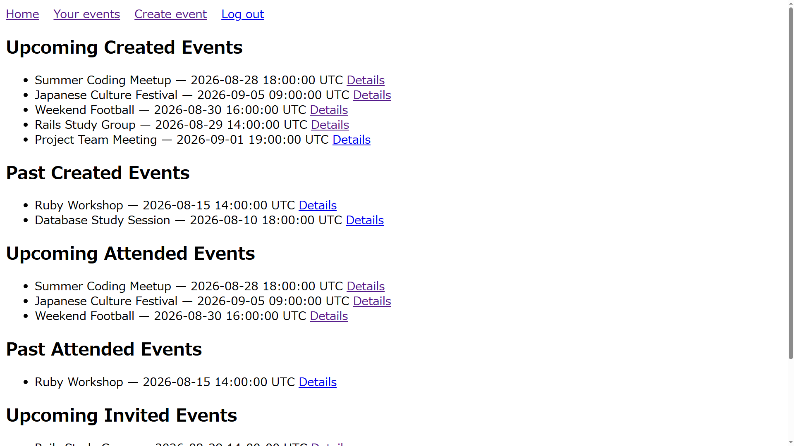
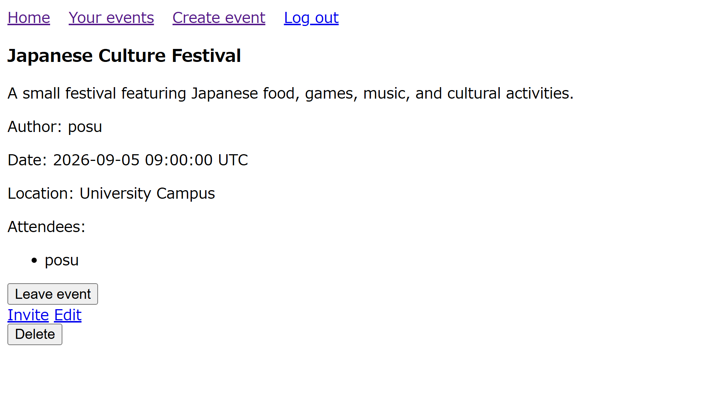

# Private Events

This is the project from [The Odin Project](https://github.com/TheOdinProject) curriculum — a private events application built with **Ruby on Rails** and **Devise**, focusing on user authentication, associations, event management, attendance, invitations, and authorization.

## Features

- User registration and login
- User logout and session management
- Create public and private events
- Associate events with their creators
- Display public events to everyone
- Allow users to attend and leave events
- Invite specific users to private events
- Display created, attended, and invited events
- Allow event creators to edit and delete their events
- Protect event management actions with authorization
- Validate user and event data
- Use scopes to separate past and upcoming events

## Preview

### Events

### Event Details

## Skills Learned

### Active Record Associations

- `belongs_to` and `has_many` associations
- `has_many :through` associations
- Custom association names with `class_name`
- Custom foreign keys with `foreign_key`
- Using `source` with `has_many :through`
- Nested resources and their relationship with model associations
- Dependent associations with `dependent: :destroy`
- Setting up foreign keys with `to_table`

### Active Record Queries

- Querying records with `where`
- Combining conditions with ActiveRecord scopes
- Creating reusable scopes for past, upcoming, and public events
- Using `find`, `find_by`, and `exists?`
- Querying through associations
- Eager loading associations with `includes`
- Avoiding N+1 queries
- Building queries through model associations

### Ruby on Rails

- User authentication with Devise
- Sessions and authentication with Rails
- Controller filters and authorization
- Model associations
- `has_many :through` associations
- Model validations
- Strong parameters
- RESTful routing
- Nested resources
- CRUD operations
- ActiveRecord scopes
- Eager loading
- ERB views and Rails form helpers
- Turbo

## Challenges

- Understanding nested resources for events, attendances, and invitations
- Setting up `has_many :through` associations between users and events
- Handling public and private events with ActiveRecord scopes
- Restricting event editing and deletion to their creators
- Implementing attendance and invitation functionality
- Managing dependent records when deleting events
- Understanding foreign keys and custom association names
- Avoiding N+1 queries with eager loading
